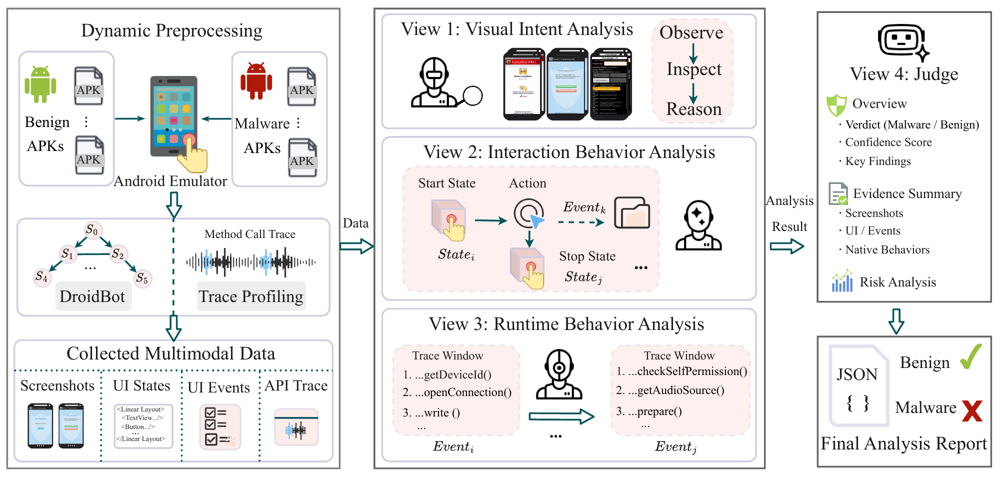

# Moirae

**A Multimodal Agent Collaborative Framework for Dynamic Android Malware Detection**

Moirae investigates Android runtime behavior with three independent evidence
agents and a final Judge. Vision examines screenshots, UI/Event reconstructs
interface transitions and interaction causality, and API investigates ART method
traces. The evidence agents run concurrently. The Judge combines their final
reports into a verdict and an evidence chain.

## Framework



*Overview of the Moirae architecture: dynamic evidence collection, independent
multimodal investigations, and final judgment.*

## Project structure

```text
moirae/
  config.py                  Paths, provider settings, and execution metadata
  collection/
    runner.py                Emulator recording and APK lifecycle management
    action_runner.py         DroidBot actions-only subprocess
    state_parser.py          Semantic state and event extraction
  preprocessing/
    trace_reducer.py          ART filtering and event-window alignment
  evidence/
    tools.py                 Role-specific evidence access and pagination
  reasoning/
    schemas.py               Structured evidence and verdict models
    prompts.py               Evidence-agent and Judge system prompts
    agents.py                Models and tool registration
    data.py                  Evidence loading and atomic output writes
    runtime.py               ReAct execution, retries, and prompt builders
    pipeline.py              Concurrent evidence analysis and batch processing
    reporting.py             Audits, timing, Token statistics, and traces
    cli.py                   Analysis command-line interface
  resources/
    whitelist_packages_java.txt
docs/moirae-framework.png     Framework figure
tests/                       Offline regression tests
.env.example                 Environment configuration template
pyproject.toml               Dependencies and command-line entry points
```

## Installation

Use Python 3.10 or newer:

```bash
python -m venv .venv
# Activate .venv using the command for your shell.
python -m pip install -e .
```

Dynamic collection also requires the Android SDK (`adb`, `aapt`, and `emulator`),
a test emulator supporting screen recording and ART method profiling, and a
compatible DroidBot checkout. Install DroidBot's dependencies in the same Python
environment. Set `DROIDBOT_ROOT` or pass `--droidbot-root`. The original experiment
did not specify a DroidBot revision or bundle a modified Android image.

## Configuration

Export environment variables before launching Python. `.env.example` lists the
available settings; `.env` files are not loaded automatically.

PowerShell:

```powershell
$env:MOIRAE_API_KEY = '<your-provider-key>'
$env:MOIRAE_BASE_URL = 'https://api.minimax.chat/v1'
$env:ANDROID_EVIDENCE_DATASET_ROOT = './data'
$env:VISION_AGENT_MODEL = 'MiniMax-M3'
$env:TEXT_AGENT_MODEL = 'MiniMax-M3'
$env:JUDGE_AGENT_MODEL = 'MiniMax-M3'
```

Bash:

```bash
export MOIRAE_API_KEY='<your-provider-key>'
export MOIRAE_BASE_URL='https://api.minimax.chat/v1'
export ANDROID_EVIDENCE_DATASET_ROOT='./data'
```

All agents currently share one OpenAI-compatible endpoint and credential. A
different Judge model must be served by that endpoint. The Vision model needs
image input and tool-call support. Legacy `MiniMax_API_KEY` and
`MiniMax_BASE_URL` variables remain supported. Actual keys, APKs, collected data,
generated reports, the Android SDK, and DroidBot are not included.

## Usage

Installation provides `moirae-collect`, `moirae-reduce`, and `moirae-analyze`.
Use `--help` to inspect each command's options.

### 1. Collect dynamic evidence

```bash
moirae-collect --apk-dir ./data/apks --serial emulator-5554 --seconds 120 --adb /path/to/adb --aapt /path/to/aapt --droidbot-root ./external/droidbot --droidbot-output-dir ./data/droidbot_out/benign --output-dir ./data/videos/droidbot/benign --trace-output-dir ./data/traces/droidbot/benign --xml-output-dir ./data/xml_states/droidbot/benign
```

The runner installs and launches APKs, records video and ART traces, executes
DroidBot actions, parses semantic events, and cleans up each app. Clean-snapshot
recovery is enabled by default. `--recovery-mode wipe-data` erases the selected
AVD's data and should be used with an expendable experiment emulator.

### 2. Reduce and align traces

```bash
moirae-reduce --trace ./data/traces/droidbot/benign --semantic-json ./data/xml_states/droidbot/benign --output-dir ./data/agent_workspace/benign
```

### 3. Analyze the evidence

```bash
moirae-analyze --agent-report ./data/agent_workspace/benign --output-dir ./outputs/reasoning
```

Supply one fused JSON file or a directory of JSON files. Directory discovery is
nonrecursive, so process each split/family directory separately. Evidence lookup
uses `ANDROID_EVIDENCE_DATASET_ROOT` independently of `--agent-report`.

```text
data/
  droidbot_out/benign/<apk_name>/states/...
  droidbot_out/benign/<apk_name>/events/...
  xml_states/droidbot/benign/<apk_name>/xml_semantic_stream.json
  traces/droidbot/benign/<apk_name>.trace
  agent_workspace/benign/<apk_name>.json
```

For malware, use a matching family directory after `malware` across all evidence
paths. Keep screenshots alongside their native DroidBot state files.

### 4. Rebuild existing reports

```bash
moirae-analyze --output-dir ./outputs/reasoning --rebuild-output-only
```

Rebuilding reads saved audits without making model calls. It does not recover a
missing Judge output. Normal batch execution skips successful samples and can
rerun evidence agents for unresolved samples.

The commands can also run directly from the source tree:

```bash
python -m moirae.collection.runner --help
python -m moirae.preprocessing.trace_reducer --help
python -m moirae.reasoning.cli --help
```

## Outputs and evaluation

| File/directory | Contents |
|---|---|
| `multi_agent_analysis_reports.json` | Verdicts, evidence chains, and status |
| `all_apks_multi_agent_context.json` | Final evidence-agent summaries |
| `all_apks_multi_agent_detailed_context.json` | Detailed evidence context |
| `multi_agent_audits/` | Prompts, messages, retries, decisions, and usage |
| `multi_agent_traces/` | Per-sample readable traces |
| `llm_multi_agent_trace_full.md` | Combined trace document |
| `timing_stats.json` | Stage times, critical path, cumulative time, and Tokens |

Filter `status == "success"` when evaluating predictions. A failed Judge can
retain a fallback `is_malicious: false`; it is not a valid benign verdict.
Missing/empty evidence is not proof of benign behavior. Missing provider Token
usage is recorded as unavailable rather than zero. Wall-clock time accounts for
concurrent evidence agents; cumulative agent time sums their individual durations.

## Offline verification

```bash
python -m compileall -q moirae
python -m unittest discover -s tests -v
```

Tests use synthetic evidence and local PydanticAI test models. They cover the
pipeline, sample resume, report rebuilding, bookkeeping isolation, namespace
matching, missing traces, and path sanitization without an emulator or paid API.
